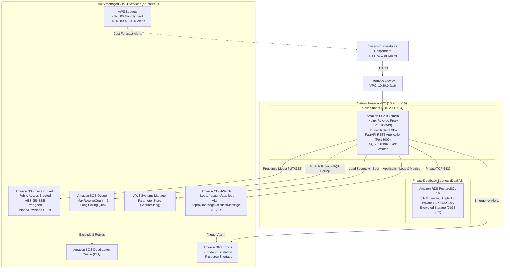
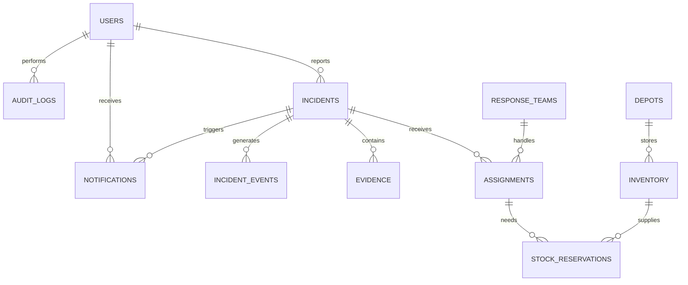
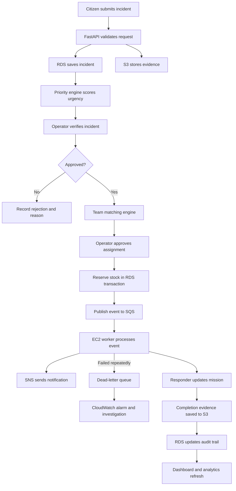

# ResQGrid: Cloud-Native Disaster Response & Intelligent Resource Coordination Platform

[](https://www.python.org/downloads/)
[](https://fastapi.tiangolo.com)
[](https://react.dev)
[](https://www.postgresql.org)
[](https://aws.amazon.com)
[](https://www.terraform.io)
[](https://docs.pytest.org)

> **Tagline:** Intelligent Emergency Coordination. Faster Response. Smarter Resource Allocation.  
> **Demonstration Focus:** Mumbai Urban Flood Response & Coordinated Relief Simulation  
> **Academic Scope:** 3-Member Cloud Computing Engineering Mini Project (Semester VI)

---

## Academic & Simulation Disclaimer
*All emergency reports, victims, responder squads, depot inventories, and flood inundation boundaries in this project are strictly simulated for academic evaluation in Cloud Computing. ResQGrid is not certified or positioned as an active public emergency dispatch service.*

---

## 1. Executive Summary & Architecture

ResQGrid is an end-to-end, cloud-native operational coordination system that models the complete operational lifecycle of simulated disaster incidents—from citizen reporting and operator triage to heuristic team matching, atomic supply reservation, and field responder completion.

### Cloud-Native AWS Infrastructure Architecture



### Relational Database Entity-Relationship (ER) Architecture



### End-to-End Operational Lifecycle Workflow



---

## 2. Interactive 3D Spatial Experience (Three.js / React Three Fiber / Drei)

ResQGrid elevates traditional flat disaster dashboards into a next-generation, high-performance spatial command interface using **Three.js, `@react-three/fiber`, and `@react-three/drei`**:

1. **Cinematic 3D Landing Page (`/`)**:
   - Stylized, procedural miniature city representing the Mumbai metropolitan basin (Western Express Highway, Bandra-Worli Sea Link, Mithi River inundation channel, coastal retaining walls, and commercial skyscrapers).
   - Scroll-choreographed and automated camera transitions across 5 operational narrative stages:
     `Surveillance` $\rightarrow$ `Emergency Ingestion` $\rightarrow$ `Priority Scoring` $\rightarrow$ `Resource Mobilization` $\rightarrow$ `Mission Resolution`.
   - Animated traffic particle streams, expanding radar sweeps, and pulsating emergency beacon heads.

2. **Interactive 3D Disaster Simulation (`/scenario`)**:
   - Fully synchronized with real backend simulation data (`/api/v1/simulations/compare`).
   - Dynamically animated rising flood water level across the Mithi River low-lying basin as simulation steps advance.
   - Interactive orbit controls, building selection, step scrubber, and live metric synchronization.

3. **3D Tactical Command Center (`/command`)**:
   - Instant 1-click toggle between 2D Leaflet mapping and 3D Tactical Command mode.
   - Tactical Layers panel (Incidents, Responders, Depots, Hazard Polygons, Dispatch Arcs, Radar Sweep) inspired by the Devpost Emergency Command Center reference UI.
   - Direct click-to-inspect linkage: selecting any 3D emergency beacon immediately opens its backend record in `TriageDrawer`.
   - Camera angle presets: Tactical Isometric, Command Overhead, and Coastal Orbit.
   - **Accessible 2D Fallback**: Full operational parity in 2D mode, ensuring operations are never blocked when WebGL is unavailable or when reduced motion is preferred.

---

## 2. Absolute Faculty Requirements Compliance

Every single one of the **17 Absolute Faculty Requirements** has been implemented, tested, and documented. See [`docs/faculty-requirements.md`](docs/faculty-requirements.md) for the detailed verification matrix.

| # | Requirement | Implemented Architecture / Resource | Code Reference |
|---|---|---|---|
| **1** | Full stack application with frontend, backend, DB | React 18 SPA + FastAPI + PostgreSQL 16 ORM | `apps/web`, `apps/api`, `apps/worker` |
| **2** | Main backend on EC2 cloud compute (not serverless) | EC2 `t3.small` in custom VPC running Docker Compose | `infrastructure/terraform/modules/ec2` |
| **3** | Custom VPC with subnets, IGW, and Security Groups | `10.20.0.0/16`, 2 Public subnets, 2 Private DB subnets | `infrastructure/terraform/modules/vpc` |
| **4** | Managed relational DB using RDS PostgreSQL | Amazon RDS PostgreSQL 16 (Single-AZ, private 5432) | `infrastructure/terraform/modules/rds` |
| **5** | Amazon S3 for genuine incident evidence | Private bucket, Public Access Blocked, Presigned URLs | `apps/api/app/services/storage.py` |
| **6** | Least-privilege IAM roles | EC2 Instance Profile with scoped S3/SQS/SSM policies | `infrastructure/terraform/modules/iam` |
| **7** | No hardcoded AWS credentials | Zero credentials in git. IAM instance profile + SSM | Audit scan verified |
| **8** | SSM Parameter Store for secure secrets | Database URL and JWT keys in `/resqgrid/prod/*` | `apps/api/app/core/config.py` |
| **9** | CloudWatch application logs & metrics | JSON logs in `/resqgrid/app-logs` + response time metrics | `infrastructure/terraform/modules/cloudwatch` |
| **10** | Working CloudWatch alarm | `ApproximateAgeOfOldestMessage > 120s` triggering SNS | `apps/api/app/api/v1/admin.py` |
| **11** | AWS Budgets cost alerts | \$20.00 monthly cap with 50%, 80%, 100% email alerts | `infrastructure/terraform/modules/budgets` |
| **12** | At least five integrated AWS services | 8 integrated services (EC2, VPC, RDS, S3, SQS, SNS, SSM, CloudWatch) | Terraform IaC modules |
| **13** | Two additional cloud capabilities | 1. SQS + Dead-Letter Queue (DLQ)<br>2. Amazon SNS Alerts<br>3. AWS Budgets | `infrastructure/terraform/modules/sqs_sns` |
| **14** | No unused decorative services | Every AWS resource is tied to an active workflow | Architecture verification |
| **15** | Demonstrate 6 cloud pillars | Compute, Networking, DB, Storage, Security, Monitoring | `docs/testing/mumbai-flood-demo.md` |
| **16** | Diagrams, docs, code, and cost breakdown | Complete documentation suite in `/docs` | Complete repository tree |
| **17** | Avoid unnecessary paid infrastructure | No NAT Gateway, Single-AZ RDS, no paid load balancer | Estimated < \$2.00 per demo run |

---

## 3. Three-Member Engineering Work Breakdown

Detailed in [`docs/team-work-breakdown.md`](docs/team-work-breakdown.md):

- **Member 1 (Frontend & Product Engineering)**: React 18, TypeScript, Tailwind design system, Leaflet command center map, Citizen portal, Responder console, Inventory interface, Browser testing.
- **Member 2 (Backend, Database & Algorithms)**: FastAPI modular architecture, PostgreSQL schema (18 tables), Explainable priority scoring engine, Two-stage resource matching engine, Transactional outbox, Pytest suite.
- **Member 3 (Cloud & Infrastructure Engineering)**: Custom VPC networking, EC2 host provisioning, Amazon RDS PostgreSQL, Amazon S3 presigned pipeline, SQS + DLQ worker, CloudWatch alarms, Terraform IaC, Cost optimization.

---

## 4. Four Role-Based Portal Experiences

1. **Citizen Portal (`/citizen`)**:
   - Geolocation incident submission with Mumbai landmarks (Kurla, Dadar, Bandra, Dharavi, Andheri).
   - Citizen evidence photo upload via S3 presigned URL pipeline.
   - Unique tracking ID generation (`INC-XXXXX`) and public live tracking (`/track`).

2. **Command Center (`/command`)**:
   - Tactical map-first operations room with real-time Leaflet visualization.
   - Live incident queue with category and urgency filtering.
   - Heuristic priority score inspector with normalized factor bars.
   - Resource matching engine recommendations with explainable bullets.
   - Operator-approved atomic dispatch and supply reservations.

3. **Field Responder Workspace (`/responder`)**:
   - Unit-scoped mission orders (authorized squad access control).
   - Stepper progression: `PENDING` $\rightarrow$ `ACCEPTED` $\rightarrow$ `EN_ROUTE` $\rightarrow$ `ON_SCENE` $\rightarrow$ `COMPLETED`.
   - Supplies consumption logging and S3 completion photo upload.

4. **Relief Coordinator Portal (`/inventory`)**:
   - Depot stockpiles and emergency shelter occupancies across Mumbai.
   - Available vs reserved quantity breakdown; atomic non-negative database constraints.
   - Low-stock threshold alerts with Amazon SNS notifications.
   - Simulated donation and replenishment intake logging.

---

## 5. Intelligent Algorithms & Empirical Benchmark

Detailed in [`docs/algorithms/intelligent-coordination.md`](docs/algorithms/intelligent-coordination.md):

### Priority Scoring Formula
$$P = 0.35 \times \text{Severity} + 0.25 \times \text{Impact} + 0.20 \times \text{WaitTime} + 0.20 \times \text{Vulnerability}$$

### Two-Stage Resource Matching
- **Stage 1 (Eligibility)**: Strict qualification filter (e.g. watercraft required for floods).
- **Stage 2 (Suitability)**:
  $$S = 0.40 \times \text{Capability} + 0.30 \times \text{Proximity} + 0.20 \times \text{Availability} + 0.10 \times \text{Capacity}$$
  *Proximity is computed via spherical Haversine distance in kilometers.*

### Scenario Commander Benchmark Findings (Mumbai Flood Dataset)
- **-65.1% Reduction** in Critical Emergency Wait Time (from 42.4m to 14.8m).
- **-33.3% Reduction** in Overall Average Wait Time.
- **+16.4% Gain** in Relief Resource Utilization.

---

## 6. Local Quickstart (Full Stack in 60 Seconds)

### Prerequisites
- Python 3.12+
- Node.js 20+ & npm
- Docker & Docker Compose (optional for full containerized stack)

### 1. Backend & Worker Setup
```bash
# Create virtual environment and activate
python3 -m venv .venv
source .venv/bin/activate

# Install dependencies
pip install -r apps/api/requirements.txt

# Run database migrations
cd apps/api && alembic upgrade head && cd ../..

# Seed realistic Mumbai demo data (Users, Teams, Depots, Incidents)
python3 scripts/seed/seed_data.py

# Launch FastAPI backend
PYTHONPATH=apps/api uvicorn app.main:app --reload --port 8000
```

### 2. Background Worker
In a separate terminal:
```bash
source .venv/bin/activate
python3 apps/worker/app/worker.py
```

### 3. Frontend Web Application
In a third terminal:
```bash
cd apps/web
npm install --legacy-peer-deps
npm run dev
```
Open **`http://localhost:5173`** in your browser.

---

## 7. Automated Testing Suite

ResQGrid features a comprehensive automated Pytest test suite covering heuristics, concurrency, RBAC, and end-to-end incident lifecycles:

```bash
source .venv/bin/activate
pytest -v
```

Expected output:
```text
apps/api/tests/test_e2e_workflow.py::test_full_incident_lifecycle_workflow PASSED
apps/api/tests/test_inventory_concurrency.py::test_inventory_atomic_reservation_and_deficit_protection PASSED
apps/api/tests/test_inventory_concurrency.py::test_rbac_boundary_enforcement PASSED
apps/api/tests/test_matching_engine.py::test_haversine_distance_calculation PASSED
apps/api/tests/test_matching_engine.py::test_matching_engine_filters_and_ranks PASSED
apps/api/tests/test_priority_engine.py::test_priority_weights_sum_to_one PASSED
apps/api/tests/test_priority_engine.py::test_critical_flood_urgency_higher_than_minor_incident PASSED
apps/api/tests/test_priority_engine.py::test_waiting_time_increases_priority PASSED
======================== 8 passed in 1.96s ========================
```

---

## 8. Evaluator Demonstration Walkthrough

Follow [`docs/testing/mumbai-flood-demo.md`](docs/testing/mumbai-flood-demo.md) for the 8-10 minute presentation script:
1. Citizen reports Kurla West flood incident with attached evidence photo.
2. Command Center verifies incident and reviews explainable priority urgency score.
3. Operator reviews top-ranked response squad (Bandra Water Rescue Alpha) and dispatches with reserved depot supplies.
4. Field Responder accepts mission, updates stages (`EN_ROUTE` $\rightarrow$ `ON_SCENE` $\rightarrow$ `COMPLETED`), and uploads proof.
5. In `/health`, pause the background worker to observe queue depth increase and demonstrate CloudWatch alarm recovery upon resuming.
6. In `/scenario`, run side-by-side benchmark comparison against Baseline FIFO.

---

## 9. Cloud Cost & Budget Protection (Mumbai ap-south-1)

Detailed in [`docs/cost/aws-budget-breakdown.md`](docs/cost/aws-budget-breakdown.md):
- **Evaluation Run (40 hours)**: **~\$1.87 USD**
- **Continuous 1-Month Operation (730 hours)**: **~\$33.77 USD** (or **~\$3.65 USD** with Free Tier)
- **High-Cost Resources Avoided**: Zero NAT Gateway (-\$32.85/mo saved), Single-AZ RDS PostgreSQL (-\$15/mo saved), no paid ALB (-\$16/mo saved).
- **Budget Protection**: AWS Budgets configured with \$20.00 monthly cap and 50%, 80%, 100% email triggers.

---

## 10. Repository File Structure

```text
resqgrid/
├── apps/
│   ├── web/                    # React 18, TypeScript, Tailwind CSS, Leaflet, Recharts
│   │   ├── src/                # Pages, Components, Context, API client
│   │   ├── nginx.conf          # Nginx reverse proxy config
│   │   └── Dockerfile          # Multi-stage production build
│   ├── api/                    # Python 3.12+ FastAPI Core Monolith
│   │   ├── app/                # Routers, Models, Schemas, Algorithms, Services
│   │   ├── alembic/            # Database schema migrations
│   │   ├── tests/              # Pytest unit & integration test suite
│   │   └── Dockerfile          # Production backend container
│   └── worker/                 # Amazon SQS / Outbox background event consumer
│       ├── app/worker.py       # Idempotent polling, retries & DLQ handling
│       └── Dockerfile          # Worker service container
├── infrastructure/
│   └── terraform/
│       ├── modules/            # vpc, ec2, rds, s3, iam, sqs_sns, cloudwatch, budgets
│       └── environments/prod/  # ap-south-1 production IaC definitions
├── scripts/
│   ├── seed/seed_data.py       # Mumbai emergency demonstration seed data
│   ├── deploy/deploy_local.sh  # Docker Compose one-touch deployment
│   └── cleanup/cleanup.sh      # Clean environment teardown
├── docs/
│   ├── faculty-requirements.md # 17/17 Verification Matrix
│   ├── team-work-breakdown.md  # 3-Member engineering ownership
│   ├── architecture/           # Cloud networking & system design
│   ├── algorithms/             # Priority & Matching heuristic math
│   ├── testing/                # Mumbai flood demonstration script
│   └── cost/                   # AWS pricing breakdown (ap-south-1)
├── docker-compose.yml          # Local multi-service orchestration
├── .env.example                # Zero credentials template
└── README.md                   # Master engineering documentation
```

---

## License
Distributed under the MIT License. Built for Cloud Computing Academic Evaluation.

