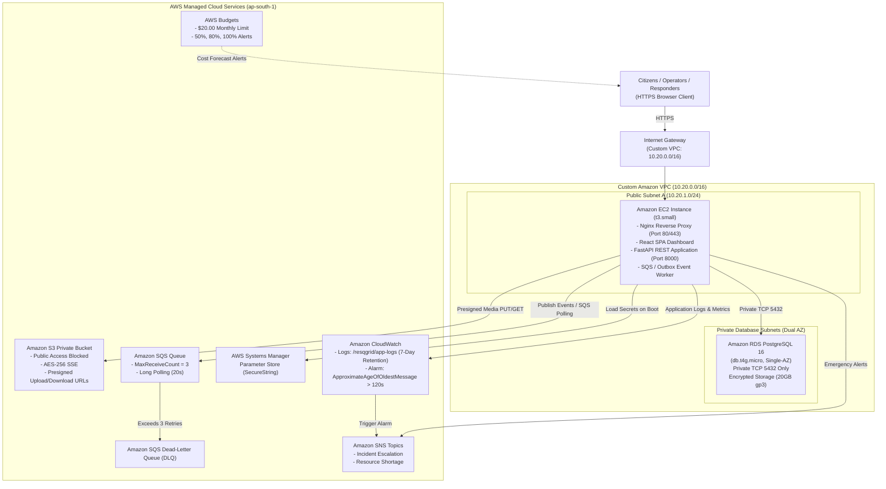
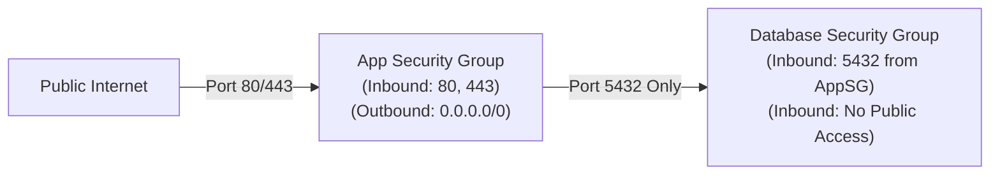

# ResQGrid — Cloud Architecture & AWS Infrastructure Design

This document details the complete cloud architecture of ResQGrid deployed in the **AWS Mumbai (`ap-south-1`)** region.

---

## 1. High-Level Architectural Diagram

---

## 2. Six Architectural Pillars Alignment

| Cloud Pillar | Service Selection & Configuration | Implementation Detail & Architectural Justification |
|---|---|---|
| **Compute** | Amazon EC2 (`t3.small`, Ubuntu 24.04 LTS, ARM64/x86_64) | Hosts containerized Nginx, React static assets, FastAPI backend, and SQS event worker via Docker Compose. Eliminates serverless cold starts for real-time operational mapping. |
| **Networking** | Custom VPC (`10.20.0.0/16`), 2 Public Subnets, 2 Private DB Subnets, IGW | Dual Availability Zone coverage (`ap-south-1a`, `ap-south-1b`). RDS sits isolated in private subnets with zero public IP addresses. NAT Gateway intentionally excluded to minimize unneeded cost ($32+/mo saved). |
| **Database** | Amazon RDS PostgreSQL 16 (`db.t4g.micro`, Single-AZ) | Normalized relational schema (18 tables), ACID transactions (`SELECT FOR UPDATE` atomic stock reservation), automated daily backups, 7-day retention, encrypted storage at rest. |
| **Storage** | Amazon S3 (Private Application Bucket) | Public access strictly blocked (all 4 flags). Server-side encryption with AES-256. Frontend generates temporary presigned URLs; object keys and metadata indexed in PostgreSQL. |
| **Security** | IAM Instance Profile, Systems Manager Parameter Store | Zero hardcoded credentials in codebase or git. EC2 assumes IAM role with least-privilege policies. Database URLs and JWT secrets stored in Parameter Store `SecureString`. |
| **Observability** | Amazon CloudWatch, Amazon SNS, AWS Budgets | Application JSON logs sent to `/resqgrid/app-logs`. Working metric alarm on `ApproximateAgeOfOldestMessage > 120s` triggering SNS notification. AWS Budgets tracks spending against a strict $20.00 monthly cap. |

---

## 3. Network Isolation & Security Group Peering

