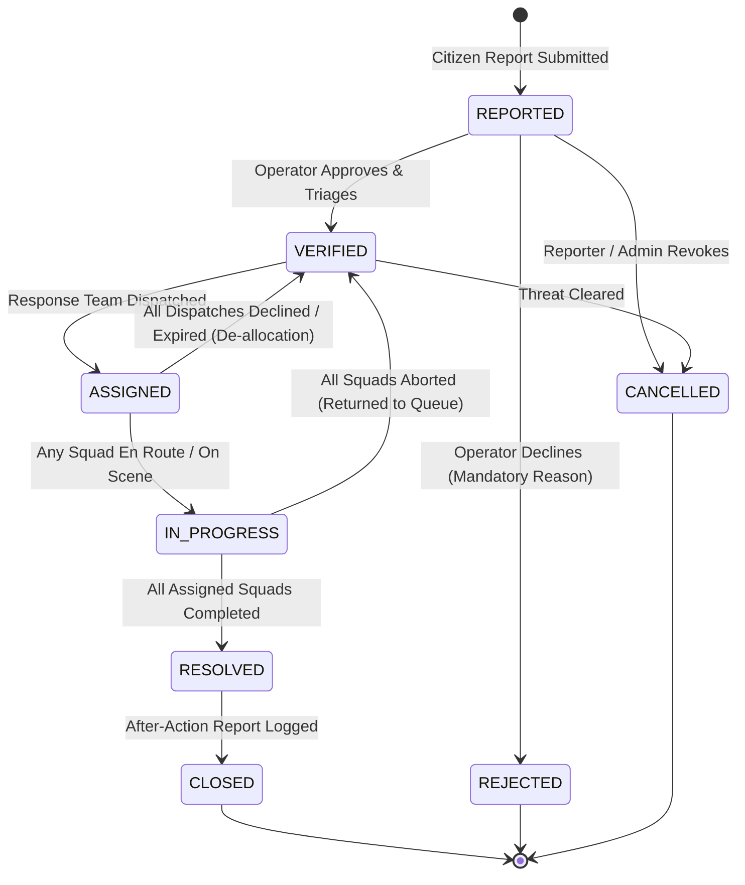
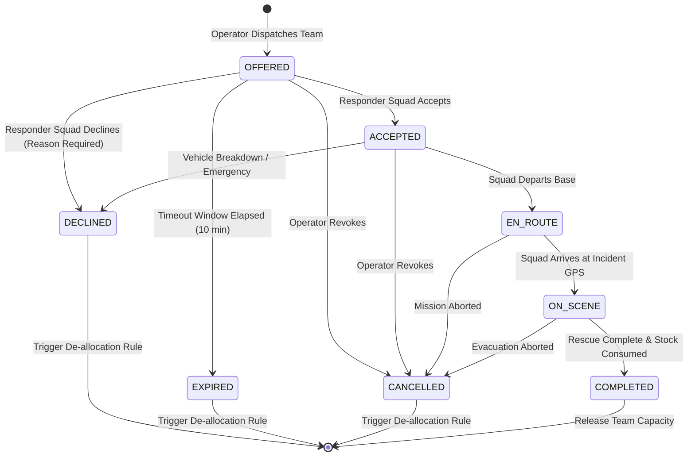

# ResQGrid Dual Connected State Machine Architecture

## 1. Architectural Overview

ResQGrid implements two distinct yet transactionally coupled finite state machines (FSMs) to coordinate disaster relief missions:
1. **Incident Lifecycle State Machine (`IncidentStateMachine`)**: Tracks the emergency incident from public reporting through operator verification, multi-team dispatch, field resolution, and archival closure.
2. **Assignment Mission State Machine (`AssignmentStateMachine`)**: Governs the operational lifecycle of an individual responder team dispatched to an incident.

The separation prevents common disaster management antipatterns where incident progress is falsely conflated with a single vehicle's movement, while single-transaction database synchronization ensures inventory, responder capacity, and incident states never drift.

---

## 2. Incident State Machine

### 2.1 State Definitions

| State | Classification | Description |
|---|---|---|
| `REPORTED` | Initial | Emergency intake registered from citizen portal or simulation engine. Initial priority computed. |
| `VERIFIED` | Active Queue | Operator reviewed and approved the report; available for response team matching and dispatch. |
| `ASSIGNED` | Dispatched | At least one response squad has been assigned and offered a mission. |
| `IN_PROGRESS` | Operational | At least one assigned squad is actively `EN_ROUTE` or `ON_SCENE`. |
| `RESOLVED` | Completed | All assigned response teams have completed their mission objectives and released remaining supplies. |
| `CLOSED` | Terminal | Command staff completed administrative review and filed after-action reports. |
| `REJECTED` | Terminal | Operator declined invalid, duplicate, or hoax report with mandatory reason. |
| `CANCELLED` | Terminal | Incident revoked prior to dispatch due to changing environmental conditions. |

> **Architectural Note on Priority**: `PRIORITIZED` is intentionally **NOT** an incident lifecycle state. Priority is an explainable numerical score ($P \in [0, 100]$) dynamically recalculated upon triage, escalation, or elapsed wait time starvation prevention.

### 2.2 Incident State Diagram

### 2.3 Independent Escalation Plane

Escalation is modeled orthogonally to incident status. An incident can be concurrently:
- `VERIFIED` and Escalated
- `ASSIGNED` and Escalated
- `IN_PROGRESS` and Escalated

Escalation captures:
- `is_escalated`: Boolean flag
- `escalation_reason`: Mandatory text justification
- `escalated_by`: User ID of operator/responder
- `escalated_at`: UTC timestamp
- `escalation_resolved_at`: Timestamp when de-escalated

---

## 3. Assignment Mission State Machine

### 3.1 State Definitions

| State | Type | Description |
|---|---|---|
| `OFFERED` | Initial | Mission created; awaiting responder acceptance or timeout. Team capacity reserved. |
| `ACCEPTED` | Active | Responder squad accepted mission and initiated pre-departure check. |
| `EN_ROUTE` | Active | Squad mobilized and in transit toward coordinates. Incident transitions to `IN_PROGRESS`. |
| `ON_SCENE` | Active | Squad arrived at location; active rescue/medical/supplies delivery underway. |
| `COMPLETED` | Terminal | Operations finalized. Stock consumed/returned. Team capacity released. |
| `DECLINED` | Terminal | Responder squad rejected mission with mandatory reason. Capacity & stock released. |
| `EXPIRED` | Terminal | Responder failed to accept within acceptance window (default: 10 mins). |
| `CANCELLED` | Terminal | Dispatch cancelled by operator prior to completion. Stock and capacity released. |
| `REASSIGNED`| Terminal | Mission transferred to alternate unit. |

### 3.2 Assignment State Diagram

---

## 4. Single-Transaction Coupling Rules

The backend couples `Incident`, `Assignment`, `ResponseTeam`, `InventoryStock`, and `OutboxEvent` inside an atomic PostgreSQL / SQLAlchemy transaction:

### 4.1 On Dispatch (`assign_incident`):
1. **Acquire Locks**: Row-level locking on `Incident` and `ResponseTeam` via `SELECT ... FOR UPDATE` + in-process dispatch lock.
2. **Version Verification**: Verify `incident.version` matches client's expected version (optimistic locking).
3. **State Guard**: Assert `incident.status == IncidentStatus.VERIFIED`.
4. **Capacity Enforcement**: Assert `team.active_assignments_count < team.max_concurrent_assignments`.
5. **Inventory Decrement**: Atomically decrement `stock.quantity_available` and increment `stock.quantity_reserved`.
6. **State Mutation**: Transition `incident.status` $\rightarrow$ `ASSIGNED`; create `assignment` in `OFFERED` status.
7. **Audit & Outbox**: Write `IncidentEvent`, `AuditLog`, and stage `OutboxEvent` in the same transaction.

### 4.2 On Decline or Expiration (`DECLINED` / `EXPIRED`):
1. **Release Capacity**: Decrement `team.active_assignments_count` and reset `team.status = AVAILABLE`.
2. **Release Stock**: Decrement `stock.quantity_reserved` and return unconsumed units to `stock.quantity_available`. Mark `StockReservation` as `RELEASED`.
3. **Queue Fallback**: Inspect remaining active missions for the incident. If zero active missions remain, atomically return `incident.status` $\rightarrow$ `VERIFIED`, re-enabling matching for other squads.
4. **Outbox Notification**: Publish event for operator alert and CloudWatch tracking.

### 4.3 On Mission Completion (`COMPLETED`):
1. **Finalize Inventory**: Reconcile actual supplies consumed vs reserved. Unused supplies returned to depot available stock. Mark reservation `CONSUMED`.
2. **Release Squad**: Decrement `team.active_assignments_count`. If zero active missions, set `team.status = AVAILABLE`.
3. **Incident Resolution Check**: Query remaining active assignments. If all assigned squads have completed, atomically transition `incident.status` $\rightarrow$ `RESOLVED`.
