# ResQGrid UI/UX Audit Report (Section 1)

**Date:** 2026-11-03 21:15 IST  
**Environment:** React 18 + TypeScript + Vite + Tailwind CSS / FastAPI Python 3.12 / PostgreSQL 16 (local SQLite mirror for dev)  
**Evidence Baseline:** 84 screenshots saved in `docs/evidence/ui/before/` across 14 routes, 3 viewport widths (1440px, 1024px, 390px), and 2 themes (light and dark).

---

## 1. Defect Verification Matrix (D1 – D14)

Every defect reported from the screen recording was rigorously audited against the codebase and live running application.

| ID | Observed Defect Description | Status | Evidence / Analysis | Planned Fix |
|---|---|---|---|---|
| **D1** | Overview shows 2 critical incidents and median response 18.5 min; Analytics shows 4 open critical and median 17.6 min. | **CONFIRMED** | • `OverviewPage.tsx` lines 143 hardcodes `18.5m` in static JSX and derives `critical_count: 2` from `/api/v1/incidents/operational-summary`. • `analytics.py` line 75 computes `open_critical_count: 4` (filtering by active statuses: REPORTED, VERIFIED, ASSIGNED, IN_PROGRESS). • The two endpoints use divergent query criteria and Overview mixes hardcoded stats with partial API data. | Unify metric contracts under `/api/v1/analytics/overview` and `/kpis`. Overview/Briefing and Analytics must query identical shared endpoints with timestamped `as_of` metadata. |
| **D2** | Analytics "Incident Lifecycle Funnel" shows Assigned 28 and En route 28 above Reported 21 and Verified 15. | **CONFIRMED** | In `analytics.py` lines 112-140, the funnel returns cumulative historic events rather than a cohort: Assigned=28, En route=28, Reported=21, Verified=15. Downstream numbers exceed upstream stages. | Rebuild funnel calculation as a monotonic cohort (incidents created in the selected time window traversing stages, strictly $N_{i+1} \le N_i$). Alternatively, label as "Stage Transition Frequency" or use honest stage distribution. |
| **D3** | "Resource util 72.5% — Optimal" is shown while "0 active squads". | **CONFIRMED** | In `analytics.py` lines 349 & 363, `resource_utilization_pct` is hardcoded to `72.5%` regardless of database state (`active_teams` is 0). In `AnalyticsPage.tsx` line 687, it displays `0 active squads` alongside `72.5% Optimal`. | Dynamically compute squad utilization from actual squad statuses: `(active_teams / total_teams) * 100`. When active squads is 0, utilization is truthfully 0.0%. |
| **D4** | Three different depots all show "Stock Availability 82%". | **CONFIRMED** | In `InventoryPortal.tsx` lines 138-141, every depot card in the `.map()` loop renders hardcoded `82%` and `style={{ width: '82%' }}`. The real depot inventory data varies (Andheri: 12.3%, Dadar: 14.4%, Kurla: 26.7%). | Compute real depot stock availability dynamically from `depot.items` or `/api/v1/analytics` (`depot_utilization` data), rendering a compact table with actual differing percentages and item counts. |
| **D5** | Cloud & Health alarm timeline cards show 12:00, 14:00, 16:00, 18:00 and "Current", but live chart runs at about 20:53. | **CONFIRMED** | In `health.py` lines 70-76, `alarm_timeline` returns a static list of 5 hardcoded timestamps (`12:00`, `14:00`, `16:00`, `18:00`, `Current`). The live telemetry uses current system clock (~21:15 IST), creating a glaring time paradox. | Generate timeline points dynamically relative to current server time `now() - N*hours`, or in local mode clearly display "Simulated historical replay (Local Mode)" with relative offsets (`-4h`, `-2h`, `now`). |
| **D6** | SNS notice names `emergency-lead@resqgrid.org`, a domain that does not exist. | **CONFIRMED** | In `admin.py` lines 19 and 67, `emergency-lead@resqgrid.org` is hardcoded as the destination for SNS email notifications. | Parameterize alert notification email via configuration/environment (e.g. `ALERTS_EMAIL` in `.env`). In local simulation mode, label explicitly as simulated dispatch inbox. |
| **D7** | Project Evidence shows "14 / 14 — 100% Compliance Verified" and "3 alarms configured: SQS Age, ALB 5xx, Stock". Architecture has no ALB; VPC CIDR is 10.0.0.0/16 vs 10.20.0.0/16 design docs. | **CONFIRMED** | In `EvidencePage.tsx` line 240, `14 / 14` is hardcoded static text rather than computed from the evidence table rows. The VPC CIDR and alarm counts are hardcoded constants in the UI rather than retrieved from Terraform outputs or backend health metadata. | Dynamically compute the verified count (`${verifiedCount} / ${totalCount}`). Synchronize VPC CIDR to `10.0.0.0/16` across all documentation and evidence tables. Accurately reflect whether ALB exists in the target environment or label as ASG Direct. |
| **D8** | Hero copy says "explainable AI priority scoring". The engine is deterministic and rule-based; it is not AI. | **CONFIRMED** | In `OverviewPage.tsx` line 92, the subtitle states: *"Multi-role triage, explainable AI priority scoring, and concurrent resource allocation..."*. The backend service `priority.py` is a deterministic multi-criteria weighted scoring algorithm, not a machine learning model. | Replace "explainable AI priority scoring" with truthful terminology: "deterministic multi-criteria priority engine" or "explainable priority scoring engine". |
| **D9** | A "LIVE WS" badge is shown while app polls. | **CONFIRMED** | In `Navbar.tsx` line 123, a green pulsating dot with `LIVE WS` is rendered unconditionally. In `WebSocketContext.tsx`, it tries to connect to `ws://.../ws` which fails and falls back to polling or disconnect, but the UI badge misleadingly indicates active WebSocket telemetry. | In local mode with HTTP polling, truthfully display: "Auto-refresh: 10s · Updated HH:mm:ss". Only display "LIVE WS" if an active WebSocket or SSE stream is genuinely connected. |
| **D10** | Citizen page shows an "Offline cache ready" badge. | **CONFIRMED** | In `CitizenPortal.tsx` line 185, `OFFLINE CACHE READY` is displayed as a decorative static badge. `sw.js` caches basic static assets but does not have an IndexedDB offline submission queue. | Remove the misleading badge, or implement a genuine IndexedDB offline emergency report queue that syncs upon reconnection before displaying the badge. |
| **D11** | Audit page claims "Cryptographically sealed" and "ACID compliant". | **CONFIRMED** | In `AuditLogPage.tsx` line 63, the description claims "Cryptographically sealed operational audit logs". In `models/incident.py`, `IncidentEvent` does not implement cryptographic SHA-256 hash chaining between records. | Remove the claim "Cryptographically sealed", or implement genuine cryptographic hash chaining (`prev_event_hash` + `current_hash = SHA256(...)`) with an on-demand verification check. |
| **D12** | One shared navigation shows every portal to an operator, with "Role: OPERATOR" visible on Citizen page. | **CONFIRMED** | In `Sidebar.tsx`, operators see all 13 nav items simultaneously. An operator browsing to `/citizen` still sees the operator sidebar with Citizen reporting controls mixed in. | Enforce distinct, role-based shells with dedicated navigation bars per role (Citizen, Operator, Responder, Coordinator, Admin). Move evaluation links to an Admin-only `/eval` section. |
| **D13** | 13 left-nav items mixing daily operations with evaluation material (Evidence, Docs, Audit). | **CONFIRMED** | `Sidebar.tsx` lists 13 items indiscriminately: Overview, Command, Mission Trace, Citizen, Track, Responder, Inventory, Scenarios, Analytics, Evidence, Audit, Health, Docs. | Streamline Operator nav to 5 core items: Briefing, Command Center, Incidents, Teams, Analytics. Relocate evaluation and internal documentation under `/eval` (gated by Admin / `VITE_EVAL_MODE=true`). |
| **D14** | Terminology drift: "squad", "team", "unit", "tactical squad" all appear for the same concept. | **CONFIRMED** | Multiple pages intermix terms: `active squads` (Analytics), `Response Teams` (Command), `Tactical Squads` (Overview), `units ready` (Health). | Standardize globally to the authoritative municipal glossary: **Team** (response entity), **Mission** (assigned response task), **Depot** (supply hub), **Incident** (reported emergency). |

---

## 2. Route-by-Route UX, Responsiveness & Contrast Audit

### 1. `/` (Overview)
- **1440px / 1024px:** Marketing-style hero section dominates the screen. Visual hierarchy looks like a SaaS landing page rather than an emergency dispatch terminal. Monospace font sizes on secondary labels dip below 12px.
- **390px (Mobile):** 4-card metric row stacks awkwardly; 3D view is forced into mobile viewports causing frame drops and battery drain.
- **Dark Mode:** Contrast on secondary slate text (`#64748b`) against `#0B132B` is borderline (~4.1:1).

### 2. `/command` (Command Center)
- **1440px:** Functional but crowded. Flood depth slider is decorative (does not feed incident scores). Severity colours rely heavily on red/orange/yellow tints without distinctive geometric shape indicators (violating WCAG 1.4.1 Use of Color).
- **1024px:** Queue and Map compete for space; detail drawer overlays map without clear close boundary.
- **390px:** Unusable in current multi-pane state; horizontal squeezing causes clipped text and overlapping action buttons. Needs tabbed switcher (Queue $\rightarrow$ Map $\rightarrow$ Detail).

### 3. `/mission-trace` (Mission Trace)
- **1440px:** Rich data presentation, but monospace query text lacks syntax highlights. Status badge styling is inconsistent with Command Center.
- **390px:** Audit event step-card timeline squishes horizontally, pushing timestamps off-screen.

### 4. `/citizen` (Citizen Emergency Portal)
- **1440px:** Form wizard is overly wide on large screens. Needs centered max-w constraint (`max-w-2xl`).
- **390px:** Step stepper wraps awkwardly on narrow devices. Offline cache badge is misleading (D10).
- **Language support:** Marathi and Hindi are only partially translated with several untranslated English strings.

### 5. `/track` (Track Incident)
- **390px:** Timeline dots and status cards align well, but ETA estimate does not indicate straight-line basis. Simulated telemetry lacks explicit simulation disclaimer.

### 6. `/responder` (Field Responder Portal)
- **1440px:** Stretched full-width desktop layout looks sparse and unnatural for what is fundamentally a mobile field tool.
- **390px:** Good touch targets, but action button states lack clear disabled/loading feedback during network latency.

### 7. `/inventory` (Relief Inventory)
- **1440px:** Depot summary cards repeat identical 82% availability (D4). Table density is fixed and cannot be toggled.
- **390px:** Table overflows horizontally without smooth scrolling indicators.

### 8. `/scenarios` (Scenario Commander)
- **1440px:** Simulation controls and comparison cards are functional, but lack confidence intervals and fast algorithmic vs integration demo differentiation.
- **390px:** Charts become cramped and unreadable at 390px.

### 9. `/analytics` (Operational KPIs)
- **1440px:** Beautiful ECharts visuals, but funnel is chronologically inverted (D2), resource utilization is detached from squad availability (D3), and sparklines lack time axis definition.
- **390px:** Heatmap matrix shrinks to illegible sub-8px cells.

### 10. `/evidence` (Project Evidence)
- **1440px:** Hardcoded 14/14 badge (D7) and static VPC metadata.
- **Evaluation leakage:** Academic grading criteria are visible directly in the operational sidebar (D13).

### 11. `/audit` (Audit Trail)
- **1440px:** Table displays raw JSON before/after states without structured visual diffing. Claims "Cryptographically sealed" without cryptographic proof (D11).

### 12. `/health` (System Health)
- **1440px:** Static alarm timeline timestamps (D5) conflict with real-time telemetry. Fake domain in notification notice (D6).

---

## 3. Planned Implementation Phases

```mermaid
graph TD
    PhaseA["Phase A: Design System Foundations<br/>- Tokens (Ink #142235, Paper #F7F8F6, Teal #137C82)<br/>- IBM Plex Sans & Mono typography<br/>- StatusMark (Shape + Color)<br/>- Base components & Gallery"]
    PhaseB["Phase B: Role-Based Shells & False Claim Elimination<br/>- Distinct shells: Citizen, Operator, Responder, Coordinator, Admin<br/>- Move Evidence/Docs to /eval<br/>- Remove false AI/Crypto/WS claims (D6-D11)"]
    PhaseC["Phase C: Command Center Redesign<br/>- 3 resizable panes (Queue, 2D Map, Detail Drawer)<br/>- Severity geometric shapes<br/>- Keyboard shortcuts (j/k, v, d, cmd+K)<br/>- Lazy 3D Twin"]
    PhaseD["Phase D: Truthfulness & Data Integrity Layer<br/>- Shared /api/v1/analytics endpoints<br/>- Monotonic cohort funnel fix (D2)<br/>- Dynamic squad utilization (D3)<br/>- Depot availability calculation (D4)"]
    PhaseE["Phase E: Remaining Pages & Mobile Adaptation<br/>- Operator Briefing (replaces hero)<br/>- Citizen wizard i18n & validation<br/>- Mobile-first Responder portal (390px)<br/>- Inventory ledger & run-out forecast"]
    PhaseF["Phase F: High-Value Features & Hardening<br/>- Duplicate incident detection<br/>- Decision explainability breakdown<br/>- What-if dispatch preview<br/>- SLA countdown chips"]
    PhaseG["Phase G: Accessibility & Verification Pass<br/>- WCAG 2.2 AA audit<br/>- Bundle budget check (<250kB initial)<br/>- Playwright test suite"]

    PhaseA --> PhaseB --> PhaseC --> PhaseD --> PhaseE --> PhaseF --> PhaseG
```

---

## 4. Next Step & Checkpoint

Audit is fully documented with all 14 defects confirmed against the live code and screenshots archived in `docs/evidence/ui/before/`. 

**Awaiting user review and sign-off on `docs/ui/AUDIT.md` before modifying any code.**

